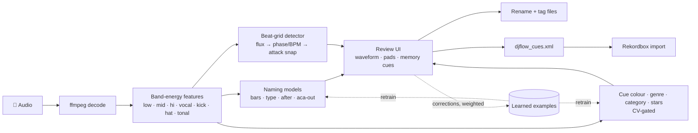

<div align="center">

# 🎧 Dmzeta Workflow

### Prepare a track for a DJ set in one pass — and let the tool learn from every correction you make.

Rename · tag · beat-grid · cue-point → **Rekordbox-ready XML**

<br>

[](https://github.com/davidmzan/dmzeta-workflow/actions/workflows/tests.yml)


</div>

---

## ⚡ At a glance

| | |
| :--- | :--- |
| **Problem** | Prepping one track meant 4 tools (Mixed In Key, Platinum Notes, Rekordbox, Metadatics) and minutes of repetitive clicking. |
| **Solution** | One local web app that proposes everything, lets you fix it on the waveform, then writes the renamed files and a Rekordbox XML. |
| **Twist** | It learns from *your* corrections: what you fix counts 3×, what you only accept 0.5×. |
| **Engineering** | Layered engine, hardened local server, 53 tests, CI with lint and type checks. No ML framework, only NumPy. |

## 🎯 What it does

| Feature | Detail |
| :--- | :--- |
| 🏷️ **Standard naming** | `Title (Mashup)(Open Show)(8 Bars POE)(In Aca)(Aca Out) - 8A - 120`. One grammar (`parse_name` / `build_name`), mirrored in JS and checked for parity. |
| 🧠 **Learned predictions** | Extender length, extender type (MOE / POE / FME), *In Aca*, *Aca Out*, genre, category and star rating, each with a confidence score. |
| 📐 **Beat grid** | Onset-flux detection, phase/BPM refinement, then snapped to the *start of the attack* of the first strong hit. |
| 📍 **Cue points** | Hot cues A/B/C/E/F/H, memory cues (INTRO, START MIX, END MIX, END LOOP), default end loop, cue C colour by vocal entry. |
| 🌊 **Waveform editor** | Zoom, drag the grid, nudge in ms, quantised or free markers, playback from any marker, full keyboard control. |
| 🔁 **Learns while you work** | Every grid nudge, colour change and name edit becomes a training example. Models retrain themselves and roll back if training fails. |
| 📊 **Model-quality panel** | Every retrain is logged; Settings shows each model's accuracy against its baseline. |
| 🛡️ **Safe by default** | Backups for every rename, one-click undo, local-only server with token and origin checks. |

## 🧩 How it works



### Design decisions worth calling out

- **No ML framework.** Multinomial logistic regression in NumPy (`Softmax.fit/dump/load`) with per-class and per-sample weights. The whole thing installs with `numpy` and `ffmpeg`.
- **Models must earn their place.** Each model is cross-validated against a *majority-class baseline*; if it does not beat it by a margin it switches itself off and leaves the field to the human.
- **Learning that weighs your own corrections.** Corrected examples count 3×, accepted ones 0.5×, unreviewed tracks are not learned from.
- **Per-file MP3 decoder delay.** Rekordbox does not trim the encoder delay ffmpeg trims for LAME-tagged MP3s, so cues landed ~38 ms early. The exporter reads `start_time` via `ffprobe` and compensates per file.
- **Atomic, reversible edits.** Renames go through a history log with backups; every shared state file is written atomically.

## 📈 Results and honest limitations

Measured on my own library with small samples, so read these as indicative, not as benchmarks.

| Area | Result |
| :--- | :--- |
| Extender length (bars) | **85 %** exact (33 / 39) on a 45-track sample |
| Extender type | 74 % on the same sample |
| *Aca Out* flag | **96 %** |
| Beat grid in Rekordbox | Within a few ms on the tracks checked visually |
| Cue C colour (red / lime) | 78 % cross-validated on 27 corrected tracks vs 67 % majority baseline |
| START MIX placement | 21 % vs 17 % baseline → **disabled** (it depends on musical judgement these features do not capture) |

**Known gaps:** Rekordbox ignores memory-cue colours and the *active loop* flag when importing XML (they live in its private database, which this tool deliberately does not touch); genre / category / star models only learn from tracks you have already tagged; the grid assumes a constant tempo.

## 🚀 Quick start

```bash
# macOS · Python 3.10+ · ffmpeg (brew install ffmpeg)
python3 -m venv .venv && .venv/bin/pip install -e .
.venv/bin/dmzeta-workflow          # opens the app in your browser
```

1. Pick the folder with new tracks and your `rekordbox.xml` (**Settings**).
2. **Analyse**, review on the waveform, **Apply + generate cues**.
3. Import `djflow_cues.xml` in Rekordbox (*rekordbox xml* view).

`instalar_djflow.command` does the same and creates a double-clickable macOS app.

## 🧪 Quality and safety

```bash
./run_tests.command        # or: python3 -m unittest discover -s tests -v
```

53 tests run in about 15 seconds on synthetic audio, in a throw-away data directory (`DJFLOW_HOME`).

| Layer | What it protects |
| :--- | :--- |
| **Golden snapshot** | The exported Rekordbox XML (positions, colours, names, loop, tempo): any accidental change fails the build. |
| **Contract tests** | The naming grammar exists in Python and JavaScript and is checked for parity with Node. |
| **Server security** | Session token, cross-origin and DNS-rebinding checks, folder allow-list, path traversal, body and range limits. |
| **End to end** | Analyse → review → rename → export cues → undo. |
| **UI tests** | `index.html` references exactly the files on disk; a Node harness boots the whole UI in demo mode. |
| **Static guards** | No undefined names, layers import only from lower layers, no personal data tracked by git. |

A `pre-commit` hook and GitHub Actions run the suite plus `ruff` and `mypy`. `./guardar_version.command "message"` commits only when everything passes. See [SECURITY.md](SECURITY.md) for what the local server enforces.

## 🗂️ Repository layout

```
djflow.py            compatibility facade + CLI
djcore/              the engine, one layer per module, each importing only from the ones above
  config → storage → names → audio → grid → preview → features
         → models → prediction → training → cues → commands
workflow_server.py   local HTTP API (token, origin checks, allow-listed folders, jobs)
ui/                  frontend: index.html + css/ (6 files) + js/ (11 files)
djflow_app.py        optional Tk desktop window
tests/               unit, contract, security, end-to-end, UI and static tests
```

Personal data (collection XML, models, caches, marks, audio) is excluded through `.gitignore`.

## 🛠️ Stack

Python 3 · NumPy · ffmpeg / ffprobe · vanilla JavaScript + Web Audio API · `http.server` · Rekordbox XML · `unittest` · ruff · mypy · GitHub Actions

---

<div align="center">

Built by **David Muñoz Zancada** ([Dmzeta](https://github.com/davidmzan)) — DJ and data engineer.<br>
The UI is in Spanish; the code and this README are in English. Released under the [MIT License](LICENSE).

</div>
